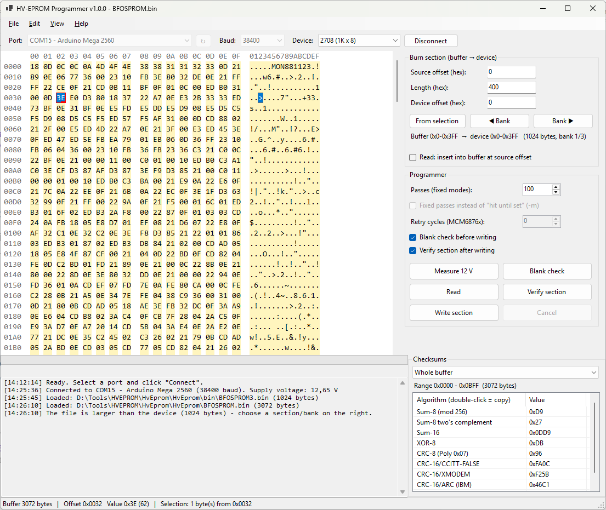

# HV-EPROM Programmer GUI

A Windows front end for the [HVEPROM](https://github.com/inaxeon/hvepromcmd) EPROM programmer by Matthew Millman.
It replaces the command line tool with a graphical program: read, write, blank-check and verify EPROMs,
edit the data in a hex editor, and burn just a section of a large file into a device.



## Features

- **Hex editor** with hex and ASCII panes, undo/redo, search, copy/paste, and a row length that adapts to the window width
- **Burn sections:** load BIN or Intel HEX files up to 16 MB and write any part of them to the device (bank navigation, device offset); read several EPROMs into one image
- **Checksums** shown live: sum-8/16, XOR, CRC-8, CRC-16 (CCITT, XMODEM, ARC) and CRC-32, for the whole buffer, a selection or the burn section
- **Programmer functions:** measure 12 V, blank check, read, write and verify, with progress, elapsed and remaining time
- **COM ports** listed with their Device Manager names (e.g. `COM15 - Arduino Mega 2560`)
- All device types of hvepromcmd: 1702A, 2704, 2708, TMS2716, MCM6876x, 8741/42/48/49, 8041/42, 8048/49/50, 8755
- English and German documentation

Tested with 2708 EPROMs (read, write, verify). The other device types follow the hvepromcmd protocol but
have not been tested on real hardware yet.

## Build

.NET 8 SDK, Windows 10/11:

```
dotnet build -c Release
```

## Documentation

* English manual: [HvEpromGui/docs/MANUAL.en.md](docs/MANUAL.en.md)
* Deutsches Handbuch: [HvEpromGui/docs/HANDBUCH.de.md](docs/HANDBUCH.de.md)

The program's Help menu opens the same manuals as HTML pages in the web browser
(`docs/MANUAL.en.html`, `docs/HANDBUCH.de.html`, generated from the Markdown files).

## License

GPL-2.0-or-later. The serial protocol is derived from [hvepromcmd](https://github.com/inaxeon/hvepromcmd)
by Matthew Millman.

---

## Deutsch

Windows-Oberfläche für den HVEPROM-EPROM-Programmer von Matthew Millman. Sie ersetzt das Kommandozeilen-Tool
durch ein grafisches Programm: EPROMs lesen, schreiben, auf Leerzustand prüfen und verifizieren, die Daten im
Hex-Editor bearbeiten und gezielt einen Abschnitt einer großen Datei in einen Baustein brennen.

**Funktionen:** Hex-Editor mit anpassbarer Zeilenlänge, Brennen von Abschnitten aus BIN-/Intel-HEX-Dateien bis
16 MB, Prüfsummen (Summen, CRC-8/16/32), Messen/Blank-Check/Lesen/Schreiben/Verify mit Zeitanzeige,
COM-Ports mit Geräte-Manager-Namen, alle Bausteintypen von hvepromcmd, Dokumentation auf Englisch und Deutsch.

Getestet mit 2708-EPROMs (Lesen, Schreiben, Vergleichen). Die übrigen Bausteintypen folgen dem Protokoll von
hvepromcmd, wurden aber noch nicht an echter Hardware getestet.

**Bauen:** .NET 8 SDK, `dotnet build -c Release` · **Handbuch:** [HvEpromGui/docs/HANDBUCH.de.md](docs/HANDBUCH.de.md) ·
**Lizenz:** GPL-2.0-or-later (Protokoll abgeleitet von hvepromcmd)
